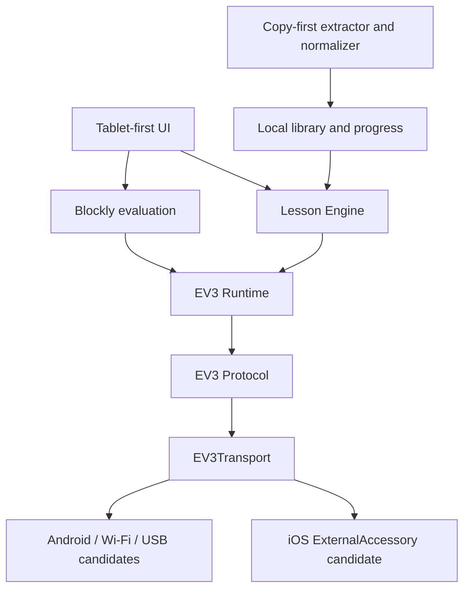

# 11 ? Tablet architecture proposal

> Historical research snapshot (2026-10-04/05), recovered onto main on 2026-10-11. Evidence and proposals below retain their original dates; they do not describe the current implementation. See [current development](../development.md), [content and conversion limits](../classroom-content.md) and [hardware validation](../manual-connection-validation.md). Hardware behavior remains UNTESTED unless a later recorded test establishes it.

**PROPOSED final architecture; browser proof implemented, device layer absent. Updated 2026-10-05.** Content preservation
and native transport feasibility can advance independently. Bluetooth remains a
product gate for iPad device control, not a prerequisite for the content model,
lesson renderer, library, offline storage or block-editor evaluation.

The earlier proof used ES modules, bundled Blockly and a private local tutorial
server. That prototype has been superseded by main; it was not a native-host
decision. See [current development](../development.md).

## Boundaries

The Lesson Engine runs normalized Activity types, never legacy commands. A
program reference can be read without executing it. Runtime exposes typed motor,
sensor, display and sound intentions; protocol handles framing/counters/replies;
transport handles byte streams, session lifecycle and platform errors. Contract
must address cancellation, serialization, partial reads/writes, bounded queues,
timeouts, stale replies, disconnect and foreground/background transitions.
An app-side stop command alone is not evidence of brick safety after host loss.

## Host candidates

| Host | Assessment | Gate |
| --- | --- | --- |
| React / TypeScript / Capacitor + Swift | Candidate: reusable lesson UI and native EASession in one installed app | Actual accessory access, authorization, touch performance and offline storage tests |
| Swift native | Candidate if native integration/lifecycle or tablet UX warrants it | Same manufacturer/protocol constraints; no assumed permission advantage |
| React Native | Candidate; shared web UI is not automatic | Same accessory constraints and additional integration costs |
| PWA | Candidate for content access/editor without promised EV3 connection | No verified Safari/EV3 GATT path; not selected as sole iPad delivery |

[18](18-ipad-accessory-bluetooth.md) documents the stronger ExternalAccessory
candidate. CoreBluetooth's GATT support does not provide arbitrary SPP/RFCOMM.
A native wrapper is an integration mechanism, not proof of permitted accessory
access. There is no proposed additional bridge for students to install/manage.
Wi-Fi/USB are separately researched alternatives, not substitutes for meeting the
owner's iPad Bluetooth objective or evidence of universal compatibility.

## Decisions that can proceed now

Define normalized Activity contracts and import diagnostics; prototype touch
lesson navigation, local import review, build-image zoom and accessible branch
choices; evaluate Blockly touch/keyboard/screen-reader interaction using original
or synthetic fixtures. Keep Library, learner progress and workspace ownership
separate. Test offline cold-start, quota failure, backup/restore and content-version
migration before selecting a durable storage backend. Do not commit to a frontend
framework solely because a sample manifest exists.

## Decision gates

Choose the mobile host through an ADR after a current iPad/brick test demonstrates
one-app pairing/session, battery/port reads, bounded motor run/stop, disconnect and
reconnect, permission/lifecycle behavior, and a distributable authorization route.
Choose runtime execution (direct streaming vs downloaded program) based on lesson
needs, timing and brick safety evidence. Compare Android separately before
claiming parity. Next milestones and unknowns: [17](17-preservation-milestone.md).
