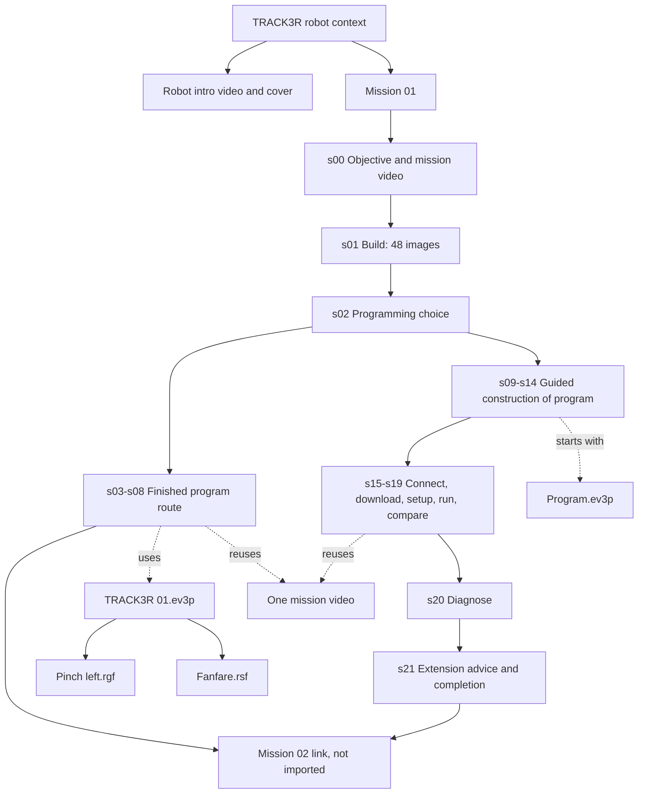

# TRACK3R Mission 01: traceable preservation case

> Historical research snapshot (2026-10-04/05), recovered onto main on 2026-10-11. Evidence and proposals below retain their original dates; they do not describe the current implementation. See [current development](../development.md), [content and conversion limits](../classroom-content.md) and [hardware validation](../manual-connection-validation.md). Hardware behavior remains UNTESTED unless a later recorded test establishes it.

**Inspection date: 2026-10-04. Status: VERIFIED static structure; normalized
representation PLANNED; playback, teaching flow and hardware execution UNTESTED.**
The installation was read only. Parsing used private temporary copies. This
document contains descriptions, locators and technical facts, not original lesson
prose or media. Local access does not establish redistribution rights.

## Evidence and reproduction

- Source product: EV3 Home Edition, installed version **1.4.4**; English support
  and Home Content registered as 1.4.4. Launcher file version: 1.0.10317.5.
- Installation root: `C:\Program Files (x86)\LEGO Software\LEGO MINDSTORMS EV3 Home Edition`.
- Mission archive `M`: `Resources/ContentPacks/Retail/en-US/LEGO/pack0/projects/1.ev3`.
- Shared project directory `S`: `Resources/ContentPacks/Retail/nonlocalized/LEGO/pack0/projects/`.
- Robot manifest: `Resources/ContentPacks/Retail/en-US/LEGO/pack0/pack.xml`.
- Robot overview: same localized project directory, `0.ev3`.
- Mission archive: **772,355 bytes**, SHA-256
  `f654be9e041f46e54e196c75e4a72587d5add2ae76de4d5e44f9afeaa9ce927f`.
- Generated evidence: [inspection JSON](evidence/track3r-01.inspection.json).
- Reproduction command and copy handling: [tools/README.md](../../tools/README.md).

The inspector records **22 slides, 334 media-reference occurrences, 112 unique
hash-addressed assets** including robot context, block definitions, metadata and
the user guide. No direct media reference is missing or ambiguous in the tested
installation. These counts do **not** imply every legacy action/help dependency
is resolved. The small sibling comparison finds **21 assets referenced by all
four other TRACK3R missions with matching content hashes**.

The complete resource map is in `assets`, `references`, `slides`, `programs`,
`relatedSources` and `actionDependencies` of the evidence JSON. Every asset has
source-relative locators, size, SHA-256 and signature-based metadata. Every
reference records its consumer/control and resolved candidate IDs. No bytes are
embedded. `!` separates archive boundaries. Slide locators are zero-based
flattened document-order indices, not original IDs or XML XPath expressions.

## Robot, mission and objective

The archive title identifies **TRACK3R 01**. The displayed activity title is
**Blend It with Precision**. The mission asks the learner to build TRACK3R with
its rotating attachment and displace a tire from the mission mat. This paragraph
is a paraphrase of the original objective, not imported lesson text.

`pack.xml` describes TRACK3R and links `projects/0.ev3`. Its image fields reference
`assets/0.png` through `assets/7.png` in the pack's nonlocalized directory. Roles
include initial, action, static, hover and title images; preserve role metadata
without reproducing hover-dependent UX on a tablet. `0.ev3` links the robot
thumbnail and introductory video. This robot context is distinct from mission 01
and must not silently become the first mission slide.

Mission `___ProjectDescription`, control texts, title/description metadata and
all nonempty textual controls are retained in the **private** `private-texts.json`
created by the tool, with exact source locators. The public report keeps
fingerprints and character counts. A production local importer should store
sanitized text in its own model; it must not load the legacy XML at lesson runtime.

## Complete slide mapping and branching

`M!Activity.x3a` contains the following 22 slides. Summaries are EV3 Studio
paraphrases. An unnamed slide is identified by index; names must not be invented
as historical metadata. The normalized example uses `s00` through `s21`.

| Index / name | Educational role and source relationships |
| --- | --- |
| 0 / Brief1 | Objective, mission video `S/1.mp4`, overlay `M!ActivityAssets.laz!1.png`; navigation to build/program/run |
| 1 / Build1 | `BuildInstructions`, ordered `ImageKey0..47` → `S/bi_1_1.jpg..bi_1_48.jpg` |
| 2 / Program1 | Choice: step-by-step instructions → ProgramInstructions1; finished program → Go1 |
| 3 / Go1 | Select `TRACK3R 01.ev3p` through OnSlideChanged; connection instructions and `go_1.png` |
| 4 / unnamed | Download finished program; `go_2.png`, legacy hardware-page help |
| 5 / unnamed | Place robot and tire; reuse mission video/overlay |
| 6 / unnamed | Run finished program; `go_4g.png`, user-guide PDF page 21 |
| 7 / unnamed | Compare physical result with the same mission video |
| 8 / unnamed | Optional power adjustment advice, completion, next-mission link; Next disabled |
| 9 / ProgramInstructions1 | Select `Program.ev3p`; explain guided editor interaction and numbered steps |
| 10 / unnamed | Add display/image operation; screenshot `S/pi_1_1.png` |
| 11 / unnamed | Add forward movement, rotations 2; screenshot `S/pi_1_2.png` |
| 12 / unnamed | Add medium-motor operation, rotations 3; screenshot `S/pi_1_3.png` |
| 13 / unnamed | Add return movement with changed parameters; screenshot `S/pi_1_4.png` |
| 14 / unnamed | Add sound operation; screenshot `S/pi_1_5.png` |
| 15 / Run1 | Connection instructions for learner-built program; `go_1.png` |
| 16 / unnamed | Download learner-built program; `go_2.png` |
| 17 / unnamed | Robot/tire setup; same mission video/overlay |
| 18 / unnamed | Run learner-built program; `go_4r.png`, guide PDF page 21 |
| 19 / unnamed | Compare result with mission video |
| 20 / unnamed | Diagnose forward distance and return power; check 2 rotations and -75 |
| 21 / unnamed | Power adjustment advice, completion, next-mission link; Next disabled |

Branching is essential: XML order is not a single lesson progression. Six named
targets and explicit actions establish the branches. Sequential Next behavior
within each branch is an **EXPERIMENTAL reconstruction** from document order and
NextButtonEnabled flags, not an observed app session. The example proposes that
mapping explicitly. Source controls include editor-oriented behavior and disabled
Next buttons. Runtime verification in the legacy app remains UNTESTED.

There is **no separately identified Challenge or Free Play step** in this mission
archive. The power-changing tip can inspire a proposed challenge but must keep
that adaptation distinct from original content. Separate Free Play content
elsewhere in Home has not been reconstructed by this mission inspection.

## Resource and dependency map

| Resource | Exact relationship | Handling |
| --- | --- | --- |
| `M!Activity.x3a` | All slide/control text, image references, navigation and editor actions | Parse/sanitize locally; output normalized typed steps and inert provenance |
| `M!Project.lvprojx` | Project references for activity, programs and NI runtime | Metadata/reference preservation; do not execute |
| `M!ActivityAssets.laz` | Nested ZIP with 13 image resources | Bounded extraction; preserve entry locators |
| `S/1.mp4` | Mission metadata and slides 0, 5, 7, 17, 19 | One asset, five presentation consumers; no duplicate video payload |
| `M!ActivityAssets.laz!1.png` | Overlay for the same video controls | Keep separate from mission thumbnail |
| `S/mission_1_hover.png` | `___LinkProjectThumbnail` | Can become tablet card thumbnail; role is source metadata |
| `S/bi_1_1.jpg..bi_1_48.jpg` | Explicit ImageKey order from Build1 | Preserve numeric index; never sort filenames lexically |
| `S/pi_1_1.png..pi_1_5.png` | Programming instruction screenshots | Preserve as reference images; old editor appearance is not modern workspace state |
| `M!Program.ev3p` | Blank guided starting workspace, one StartBlock | Preserve as original reference; do not claim converted workspace |
| `M!TRACK3R 01.ev3p` | Finished example program | Parse structural semantics; execution and conversion remain UNTESTED |
| `M!Pinch left.rgf`, `M!Fanfare.rsf` | Display and sound program arguments | Preserve binary bytes locally; decode/render separately |
| `S/TRACK3Rtxt.png`, navigation icons, tip/step graphics | Shared presentation resources | Hash deduplication; 21 sharing relationships verified across sibling missions |
| PBR `.vix` definitions | Four method targets in the program | Located and hashed, not decoded or ported |
| `.../Retail/en-US/.../2.ev3` | Next-mission action | Located/hash recorded; not part of imported mission 01 |
| `Resources/EditorHelp/Retail/en-US/ev3_user_guide.pdf` | Run instructions, page 21 | Located and hashed; rendering not tested |

Legacy `OpenWebsite` help URIs target ConnectingToBrick, HardwarePage,
ProgrammingEnvironment, Move and MediumMotor pages. Their page/fragment resolution
is **UNKNOWN** in this inspection. The local `page.html` help wrapper exists but
does not establish availability of those exact pages. No HTTP(S) media URL is
referenced by this mission's direct controls. Legacy custom URI schemes still
represent dependencies on the historical application, not on EV3 Studio.

`ShowPaletteItem` must become a modern editor hint only after a block mapping
exists. `GoToProgram` means select/load a reference, not run it. Navigation is
converted to typed graph edges. Legacy actions are never evaluated as scripts.

## Videos and images

| Source | Signature/sample entries | Dimensions / duration | Status |
| --- | --- | --- | --- |
| `S/1.mp4` | ISO BMFF; `avc1`, `mp4a`; also RTP hint entries | 1280×720; 5.6 s | VERIFIED container metadata; playback UNTESTED |
| `S/0_ProjectVideo.wmv` | ISO BMFF, despite suffix; `avc1`, `mp4a` and hint entries | 1280×720; 16.04 s | VERIFIED metadata; playback UNTESTED |
| `S/0_ProjectThumbnail.jpg` | PNG, despite suffix | 460×259 | VERIFIED signature/dimensions |
| Build sequence | JPEG signatures | 48 ordered files | VERIFIED resolution; visual instructions/alt text not reviewed |

`avc1` is an AVC sample-entry identifier. The audio object type inside `mp4a`,
codec profiles, bitrate and iPad HTML5 playback are **UNKNOWN/UNTESTED**. A sample
entry is not a playback test. No transcoding was done. First probe exact codecs,
then test local playback in WKWebView on target iPads; convert only an unsupported
sample with recorded source/output hashes and derivative metadata.

## Automatic importability classification

| Category | Static result | Remaining work |
| --- | --- | --- |
| Archive inventory, SHA-256, nested ZIP | VERIFIED by tool | Production limits, transactional library import |
| Media resolution and deduplication | VERIFIED for this mission | Codec/playback/accessibility tests |
| Ordered builds, image/video associations | VERIFIED extraction | Normalized viewer and visual fidelity |
| Text and metadata | VERIFIED private text extraction and source locators | Sanitized text AST, localization and rendering fidelity |
| Branches and editor actions | Partially recoverable; proposed mapping | Observe legacy flow; map modern editor capabilities |
| Program structure/constants/wires | VERIFIED parsing | See [program analysis](16-track3r-program.md); no automatic full conversion |
| Legacy help and palette integrations | Partially representable | Resolve help; replace unsupported actions with visible explanations |
| RGF/RSF | Binary preservation feasible | Decoders and hardware behavior UNKNOWN/UNTESTED |

The research tool demonstrates reconstruction of the mission's direct content
relationships. **An end-to-end functioning educational importer/player has not
been demonstrated.** See [content model](12-content-schema.md), [reference manifest](../content/track3r-01.manifest.example.json)
and [milestone limits/next step](17-preservation-milestone.md).
